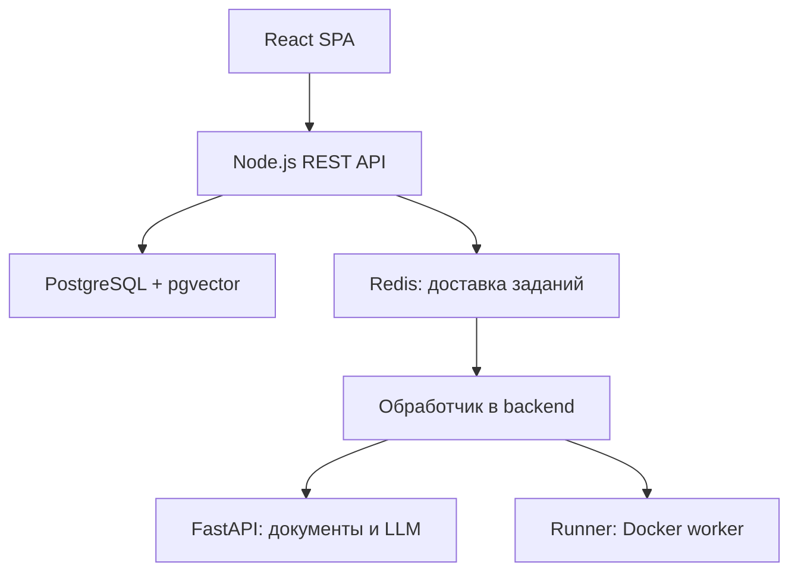

# Архитектура QA Atlas 0.8.1

React/TypeScript собирается Vite и раздаётся Node.js backend с одного origin. REST API проверяет cookie-сессию, Origin и права участника проекта. Python FastAPI извлекает документы и обращается к внешнему Chat Completions API. Runner управляет одноразовыми Docker worker-контейнерами.

## Хранение и миграции

PostgreSQL — основная production-БД. `DATABASE_URL` обязателен при `NODE_ENV=production`: сервер не переключается молча на SQLite. SQLite остаётся локальным тестовым адаптером и источником миграции старых установок. `database.mjs` применяет SQL-миграции с журналом `schema_migrations`, затем совместимое обновление старых сроков сессий до BIGINT. Аккаунты, проекты и история не удаляются.

Таблицы `accounts`, `sessions`, `login_attempts`, `account_tokens` обслуживают авторизацию; `projects`, `members`, `profiles`, `invitations` — совместную работу; `jobs` — задания и снимки автопрогонов. Тесты, требования и исходники входят в JSON проекта с ревизией. Изменения проекта и результат импорта/генерации фиксируются в одной транзакции. Устаревшая ревизия вызывает явную ошибку, без перезаписи новой работы пользователя.

PostgreSQL-адаптер использует worker thread с синхронным ожиданием SQL-ответа. Это ограничение производительности; высокая конкурентная нагрузка не проверена. Redis не заменяет PostgreSQL и не хранит единственную копию результата.

## Очередь

Backend сначала сохраняет задание в PostgreSQL, затем отправляет ID в Redis. Обработчик использует извлечённый ID. Если очередь Redis пуста, queued-задания восстанавливаются из PostgreSQL. После переподключения Redis обработка возобновляется; ошибки отправки перехватываются. При недоступном Redis задания остаются queued до восстановления сервиса. Отмена доступна через UI.

При перезапуске backend незавершённые running-задания получают failed с объяснением; queued-задания возобновляются. Успешные результаты сохраняются. В проекте допускается одна активная задача, глобально не более 20; повторная активная отправка получает 409. Повторный импорт того же документа пропускает уже существующие исходные ID, не удаляя записи. Выполнение — последовательно, **один backend-инстанс**. Распределённые блокировки для нескольких реплик не реализованы.

Импорт принимает файл до 10 МБ и сразу возвращает 202. Python извлекает до 500 страниц / 1,5 млн символов, не обрезая документ молча. Явные REQ-заголовки отделяют требования, нумерованные условия сохраняются внутри них. Десятичные числа не создают новые требования. OCR отсутствует. Проверка фикстуры на 51 страницу не заменяет нагрузочный тест всех PDF.

## Генерация и выполнение

ML задаёт квоты по основным requirementIds. При count ≥ числу требований каждому отводится как минимум один сценарий. Проверяются схема, связи, Given/When/Then и синтаксис кода. При ошибках или пропущенных требованиях допускается один дополнительный запрос — всего максимум два обращения к модели за задание. Повтор запрашивает недостающие требования, принятые сценарии сохраняются. Backend повторно проверяет принадлежность ID выбранным требованиям, вычисляет пропуски и помечает частичный результат в UI. Семантическую корректность утверждений всё равно проверяет человек.

Runner передаёт снимок исходников и тестов в Docker worker без сети, с read-only rootfs, ограничениями памяти/PID и сброшенными capabilities. Python запускается через pytest + coverage.py; JS — Playwright Test + c8 для Node-модулей. Результаты, traceback и покрытие берутся из реального исполнения. Ошибка сбора тестов или пустой набор не превращаются в PASS. JUnit только экспортируется. Покрытие кода браузера отдельно не реализовано.

## Семантические эмбеддинги и pgvector

`backend/src/vectors.mjs` запрашивает реальные нейросетевые векторы через native Yandex textEmbedding API либо OpenAI-compatible /embeddings. Для OpenAI используется одна модель для документов и запросов. Для Yandex используются согласованные document/query модели одного семейства text-search. DeepSeek/chat-модель генерации тестов не используется для эмбеддингов.

Все требования разделяются на фрагменты до 1800 байт UTF-8 без обрезания текста. Набор слов больше не хешируется в псевдоэмбеддинг. SHA-256 остаётся только для идентификатора конфигурации и проверки изменений текста — в поиск эти хеши не попадают.

Задание embeddings проходит через существующую PostgreSQL/Redis очередь. Внешние запросы ограничены тайм-аутами; отмена прекращает дальнейшую работу. До полной валидации всех ответов старый индекс не меняется. Затем в одной транзакции проверяются права, статус отмены и ревизия проекта, записываются semantic_chunks и метаданные semantic_indexes. Ошибка откатывает замену. Остановка backend оставляет running-задание явно неуспешным при следующем старте, как и остальные задания.

Миграция `backend/migrations/postgres/0001_semantic_vectors.sql` выполняется автоматически только в PostgreSQL, не удаляя legacy requirement_vectors или пользовательские записи. Новые таблицы каскадно удаляются только при явном удалении соответствующего проекта. Размерность vector не фиксируется в DDL: она проверяется по всем фрагментам и поисковому запросу, хранится в метаданных. Модель, endpoint, размерность и версия разбиения образуют идентификатор конфигурации. Изменение конфигурации либо требований делает индекс устаревшим и блокирует поиск до перестроения.

Поиск использует pgvector cosine distance `<=>` по фрагментам текущего проекта, возвращает пять требований с максимальным сходством. Это точный поиск, ANN-индекс не создаётся; масштабирование за пределы учебных проектов не проверено. Сходство не является процентом правильности или доказательством покрытия. UI находится в разделе покрытия. Готовый индекс также даёт дополнительный контекст для атомарных черновиков; если embeddings API временно недоступен, генерация продолжает работу по выбранному требованию с явным предупреждением.

Без настройки API поиск сообщает причину недоступности и не подменяет векторы хешированием. Подробности моделей, настройки, лимитов и фактических проверок — SEMANTIC_EMBEDDINGS.md.

## Эксплуатация

Именованные volumes PostgreSQL и Redis сохраняются при обычном down/up. Backend healthcheck выполняет SQL-запрос; Compose ожидает готовности БД, Redis, ML и runner. Worker-образ собирается из исходников в этом же Compose-проекте. Публично доступен только backend на localhost:8080, опционально Caddy для HTTPS. Секреты передаются через окружение. Docker socket у runner требует доверенного изолированного хоста. Проверенные границы перечислены в SEMANTIC_EMBEDDINGS.md.

## Анализ истории прогонов (0.8.1)

Frontend получает существующий API `/projects/:id/auto-runs` (до 50 записей). `runAnalysis.ts` сравнивает снимки, агрегирует индивидуальные результаты по caseId и ищет чередование результатов внутри одинаковых версий кода/исходников. `RunIntelligence.tsx` отображает сравнение, фильтры, кандидатов и ссылки на доказательства; экспорт использует общий `download.ts`. Анализ не меняет данные, не требует новых таблиц и не вызывает AI. Ограничения сопоставления описаны в FEATURES_0.8.1.md.
